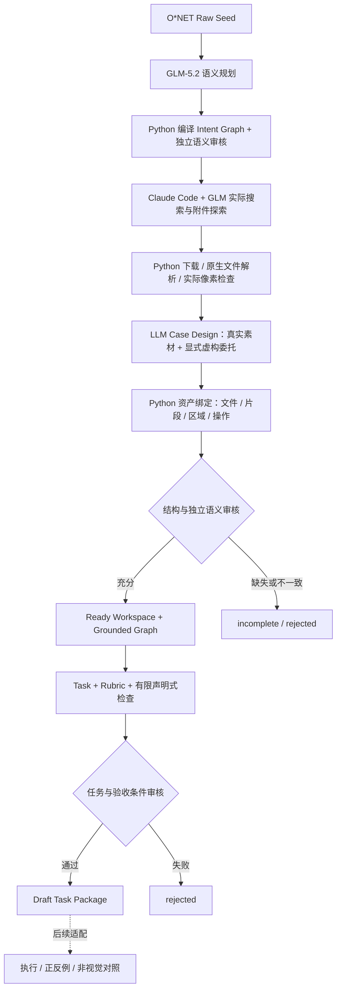

# Stage 2–4 · Intent Graph → Asset-Grounded Graph → Draft Task

本轮保留 Stage 2 的职业规划，新增 Stage 3 的实际资产绑定，沿用 Stage 4 构造入口。默认总入口为 `workspaces/scripts/run_pipeline.py`。Stage 1 官方原文与已有历史实验不改动。



**两层图回答不同问题。** Intent Graph 保存抽象职业信息需求和操作依赖；Grounded Graph 将需求绑定到真实文件及可恢复位置，并具体化工作操作与交付物。模型选择已有短引用句柄，Python 恢复规范 File/Segment ID、原始片段、页码/区域/时间戳。模型不创建事实位置。原始响应保留在缓存；不适用字段的空值和额外说明由编译器整理，不补专业前提。

实际文件不存在、引用 ID 错误、关键输入缺失、音频未检查、职业意图改变等情况仍然阻断。所有原生输入禁止 HTML；网页只用于发现和来源追溯。Web 开发任务可以交付 HTML，因为输出文件与搜索到的网页是两回事。

## 实际能力及边界

| 环节 | 本轮实现 | 尚未证明 / 尚未实现 |
|---|---|---|
| 规划 | 固定词表、DAG、格式偏好、独立审核；10 条预先指定 Seed | 全量职业覆盖的生成质量 |
| 检索 | 完整 Claude Code 会话调用 WebSearch/WebFetch；无固定工具次数/轮数上限；900 秒会话超时 | 无凭证时不会声称已联网；搜索不保证完整 |
| 图片/PDF | 实际解码与模型像素检查，区域及图像哈希 | VLM 观察不是独立真值；PDF 仅检查配置页 |
| 视频 | ffprobe 元数据、4 个固定比例时间点的解码帧及 VLM 观察 | 完整时序、动作连续性、对白与音轨理解 |
| 3D | Blueprint 支持模型交付；参考图可以作为真实输入 | 原生 3D 输入的深度几何/多视图解析与渲染 |
| 补充材料 | 明确标为虚构的用户范围、观众与呈现偏好 | 不生成业务事实文件；不实现通用配套文件合成 |
| 验收 | 原有确定性检查；新增 HTML/ZIP/视频/OBJ/glTF/GLB/二进制 STL 的有限结构检查 | 文件可读不等于功能、剪辑质量或几何正确；BLEND 不支持可读性准入 |
| Stage 5 | 既有文本任务 Probe 保留；新检查器有正反例工程测试 | 新资产任务的视觉执行适配、多次 Rollout、消融、难度校准 |

语义规划、Case 与 Task 使用已配置的 GLM-5.2。实际像素检查单独配置 `QWEN_40e5sh`（网关返回 qwen3-vl-plus），没有将 GLM 文本接口冒充视觉接口。凭证从本机 llmctl/环境变量读取，不写入配置或任务包。

`ready` 表示通过当前构造审核，可供 Stage 4 使用；`draft` 表示等待实证测试。二者均不等于任务已可解、Verifier 已可靠或视觉信息不可替代。本轮新 `asset-task-v1` 不交给旧文本 Probe 自动评分，避免不同证据接口被误判为成功。

## 运行

需要 Python 环境、`claude`、`ffmpeg`、`ffprobe`；已有 `workspaces/requirements.txt`。搜索使用当前 Claude Code/LLMCenter 的实际工具，不依赖 Tavily Key。图片与 PDF 检查通过已有 Pillow / pypdfium2 解析能力。

```bash
# 当前预先指定的 10 条 Seed → Stage 4；结果按各阶段准入数量递减
.venv/bin/python workspaces/scripts/run_pipeline.py --limit 10

# 同一输入、配置、代码和本机缓存：不重新联网或调用模型
.venv/bin/python workspaces/scripts/run_pipeline.py --limit 10 --offline

# 分阶段与统计
.venv/bin/python workspaces/scripts/run_pipeline.py --through-stage 2 --limit 10 --offline
.venv/bin/python workspaces/scripts/construct_workspace.py \
  --plan-dir work-plans/data/asset_pilot_v2 \
  --seed-file work-seeds/data/raw_work_seeds/digital_task_pool.jsonl \
  --config workspaces/config/asset_pilot.json \
  --output-dir workspaces/data/asset_pilot_v4 \
  --cache-dir workspaces/data/cache_assets --stage verify
.venv/bin/python workspaces/scripts/summarize_asset_pilot.py

.venv/bin/python -m unittest discover -s work-plans/tests -q
.venv/bin/python -m unittest discover -s workspaces/tests -q
.venv/bin/python -m unittest discover -s work-tasks/tests -q
```

新批次请改配置的 `pilot_seeds` 并使用新的 `--plan-dir --output-dir --task-dir --task-report-dir`；不以覆盖历史失败来制造成功。缓存键包含模型请求、Prompt 和相关配置。同一来源优先重放缓存字节，不下载变动后的网页。上游数据哈希不符时会阻断；不手工改 ready 标志。

## 产物位置

- `work-plans/data/asset_pilot_v2/`：10 条规划记录、3 条准入 Intent Graph。
- `workspaces/data/asset_pilot_v4/WS_*/workspace_init/`：实际保留的原生输入。
- 相邻 `construction/`：搜索轨迹、源清单、文件检查、Case、Grounded Graph、独立审核和构造报告；不交给 Agent。
- `work-tasks/generated/asset_pilot/TASK_*/`：通过审核的 Draft，含 `task.json`、输入副本和私有评测资料。
- [可在 GitHub 审阅的 Draft Task JSON](work-tasks/data/asset_pilot_current/drafts/TASK_19388cd71ca0f5bdb02185f5/task.json)：原样任务定义快照；完整附件保持本机私有。
- `work-tasks/data/asset_pilot_current/`：Stage 4 全部准入/拒绝结果。
- [本批统计和三条完整处理记录](workspaces/data/asset_pilot_v4/report.md)、[机器可读报告](workspaces/data/asset_pilot_v4/batch_report.json)。

Agent 只接收 `task.json`、`workspace_init/` 与空输出目录。可用现有 `construct_tasks.py --export-agent PACKAGE --destination DEST` 导出。原始资产许可尚未独立确认，文件及大段解析内容默认不提交 Git，也不标为可公开分发。

这是**开发批次**，包含 Prompt/接口修改后利用相同检索缓存重新构造的结果；不能把它当独立留出集的成功率。三类职业在生成前确定，失败的 Seed 一并统计。不同阶段的分母以及搜索页下载与实际原生文件数量分别报告。

## 方法依据

- [GraphForge §3.2–3.3](https://arxiv.org/html/2609.38923v3)：先组装真实文件 Workspace，再建立 Evidence Graph；具体 Task/Rubric 受文件事实约束。
- [WorkFactory §3.3](https://arxiv.org/html/2610.37161)：信息规划与信息载体绑定，结合真实资料获取、适配和合成。
- [WorkForge §2.2](https://arxiv.org/html/2610.04906)：资源获取与 Workspace Profiling，使任务设计有实际事实依据。
- [WorkGenesis](https://arxiv.org/html/2609.39325)：真实 Anchor 与合成配套材料路线，未在本轮实现其完整合成流程。

本项目的“两层图”、字段词表、素材准入规则和测试协议是自主设计，不声称复现论文未公开的实现。没有将这些论文描述为纯凭空合成。

后续 Stage 5 应分别诊断任务缺陷、Verifier 缺陷与求解器能力不足。文本/非视觉对照成功的任务仍可保留为普通 Work；Rollout 失败也不直接证明任务无效。难度需根据预先定义的多次执行统计校准，不能现在主观贴 L1/L2/L3。训练/评测应按来源项目和资产族分组，再去重划分；本轮尚未进行该划分。

## 本轮验证结果

10 条规划输入 → 3 条准入 Blueprint → 2 个 ready Workspace → 1 个 Draft。三个保留的真实搜索会话共 25 次 WebSearch、75 次 WebFetch；9 个不同原生文件通过解析，包括 1 个视频。发现页下载不计为原生工作文件。开发期间另取消过一次重复检索（4 次搜索、2 次页面读取），单独记录在报告的 development_overhead 中。

成功的 Draft 为 News & Updates 网页模板，交付 HTML / SCSS / JS 的 ZIP 包，输入是实际设计规范与 Sass 文件。它目前是普通 Web Work，未声称具备视觉必要性。概念图 Workspace 达到 ready，但 Task 的视觉验收规范被独立模型审核拒绝；视频 Workspace 只取得部分可追溯素材，保持 incomplete。3D 专项 Seed 未通过本轮 Stage 2，没有伪造 3D 成功案例。

全部 175 项测试通过（Stage 2：22，Stage 3：81，Stage 4/5：72）。当前代码与缓存进行了两次完整离线重放，49 个规划、构造、任务与文件哈希保持一致。

[验收器工程对照](work-tasks/data/asset_artifact_controls.json)：空提交被文件检查拒绝；仅放 README 的可解析 ZIP 只能通过容器检查，关键语义项仍 pending、总分为 null，不能获得任务成功或训练准入。未将这些测试当作正确任务解答或真实 Rollout。
