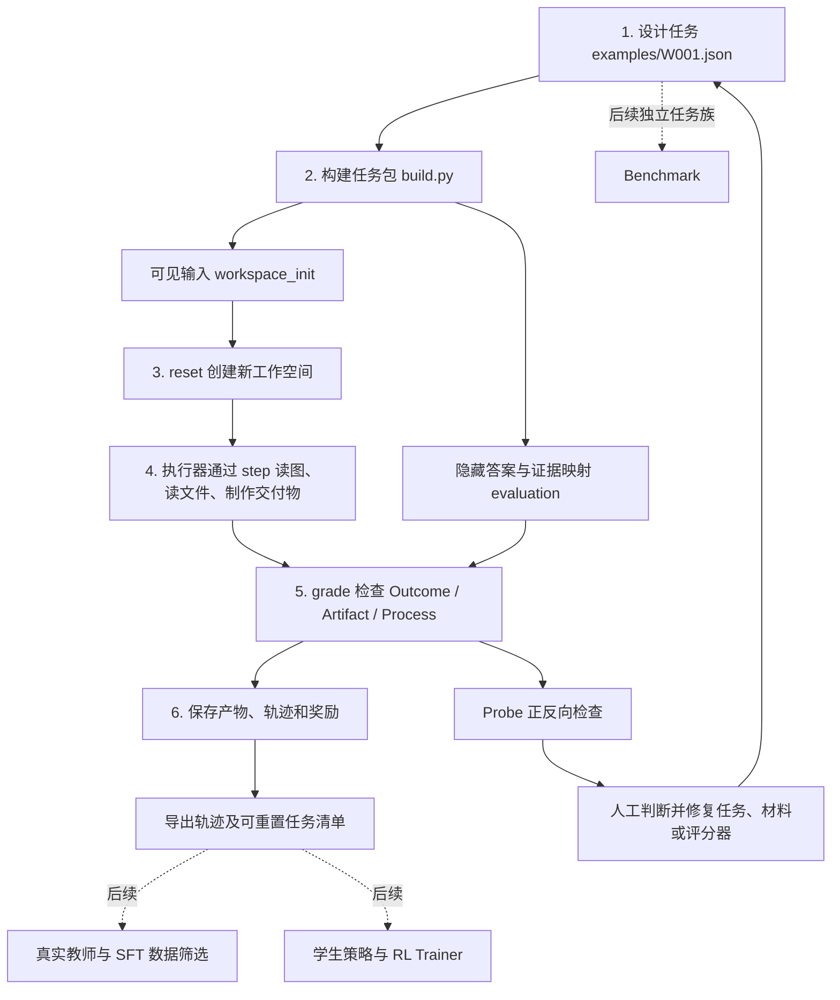

# Executable Multimodal Work Environments for Agent Learning

当前默认研究流水线为 **Stage 1 Raw Seeds → Stage 2 Work Blueprint → Stage 3 Graph-guided Workspace Construction**。Stage 1 保留 5,745 条官方原文数字候选；Stage 2–3 已重构为直接读取 Raw Seeds，不再默认依赖历史 LLM 改写的 Work Demand。

当前 Stage 2 已更新为 **LLM 语义规划 → Python Graph 编译 → 独立审核**，加入输入/输出候选格式，范围收敛到文本、文档、表格、图片和代码。相同 10 条真实 Seed：结构通过 **6/10**，语义准入 **5/10**（上一版 5/10、2/10）。4 条类别/格式错误、1 条审核 JSON 错误均保留，未人工修复。原文未改动，本轮没有生成新的 Workspace。

```bash
.venv/bin/python -m pip install -r workspaces/requirements.txt
.venv/bin/python work-plans/scripts/plan_intents.py --limit 10
# 本机已有本轮响应缓存时可离线重放
.venv/bin/python work-plans/scripts/plan_intents.py --limit 10 --offline
```

当前产物：[准入 Blueprint](work-plans/data/semantic_pilot/blueprints.jsonl)、[逐条对照和实际示例](work-plans/data/semantic_pilot/comparison.md)、[Stage 2 说明](work-plans/README.md)。后续 [Stage 3](workspaces/README.md) 默认消费新接口，实际检索时可以选 [Claude Code 搜索后端](workspaces/CLAUDE_SEARCH.md)；上轮该后端下载解析过 1 个网页，但仍未产生 ready Workspace，历史记录不计入本轮结果。

历史对照实验：[同 Seed 真实检索 / 受控世界对照](workspaces/WORLD_PILOT.md)。项目监控任务的真实路线仍 incomplete；模型生成的虚构世界已渲染为 5 份输入文件，附实验任务和数值验证规则，状态为 experimental_draft。30 个数值/单位错误均被检出，但语义审核仍容忍了叙述和规则信息缺口；没有独立 Agent Probe，不标为 ready/verified，不替换默认主流程。

随后修正了把 Claude Code 限成单次查询的接法：[自主检索实测](workspaces/AGENT_SEARCH.md)。完整上下文会话实际进行了 10 次搜索、31 次页面读取；耗尽轮数后的无工具收尾及 Python 独立获取得到 1 个真实项目 PDF、3 份 CSV 内容和来源页。仍未形成 ready Workspace，不能把获取文件与信息充分性混为一谈。

Phase I 为 Stage 1–4，目标产物是 Draft Work Task Package；Phase II 为 Stage 5 独立执行验证；Phase III 为 Stage 6–7 训练数据和评测。Stage 4 已迁移到新版 Raw Seed / Blueprint / Workspace 接口；[原生文件实验](work-tasks/NATIVE_FILE_PILOT.md) 实际生成了 1 个通过结构和独立语义审核的 Draft，输入不含 HTML。[Stage 5 实际执行实验](work-tasks/STAGE5.md) 已生成报告并完成错误产物测试，当前为 `needs_review`，未准入训练。旧 Stage 2–3 实验移入各模块 `archive/`，旧阻断报告继续保留。下方 W001/P001 是独立开发演示，不能计入本轮研究产出。

Phase 1 之后的首个种子实例：[P001 · 采购供应商比选](work-tasks/P001/README.md)。从官方 Task 1144 出发，提供合成材料、证据图、验收规则及参考执行；属于开发样例，尚未准入训练集。

这是依据 [V0 方案](数据制造方案.md) 搭建的最小可运行框架。先让一个 W001 销售分析任务走完整个流程，再逐步设计每个环节。原方案保持不变。

当前能真实生成 PNG / XLSX / PDF，重置工作空间、执行受控工具、检查交付物、保存轨迹和奖励。执行器是**手工参考样例**，没有接入模型，也没有进行 SFT / RL 训练。

## 先运行一次

在项目目录中执行（本次已安装依赖并完成演示）：

```bash
python -m venv .venv
.venv/bin/python -m pip install -r requirements.txt
.venv/bin/python -m workenv demo
```

`demo` 首次自动构建任务包，之后每次创建新的执行目录。预期 `success: true`、`reward: 1.0`。这表示参考解通过了当前验收规则，不代表模型能力或真实职业质量已经得到验证。

终端会打印 `run_directory`。打开里面的：

- `workspace/dashboard.png`：模型应观察的最新转化率看板。
- `workspace/sales_summary.xlsx`：本次生成的汇总表。
- `workspace/quarterly_brief.pdf`：本次生成的两页简报。
- `trajectory.jsonl`：每一步动作与观察。
- `grade.json`：三个维度的分数、每项检查与总奖励。

## 用一张图理解流程



图中的实线流程已实现；虚线部分是后续接入点。Probe 目前只报告问题，由人决定修复哪一环，不自动改写任务。

## 每个环节只回答一个问题

| 环节 | 要回答的问题 | 先看哪个文件 | 输入 → 输出 |
|---|---|---|---|
| 任务设计 | 用户到底要完成什么工作？ | `examples/W001.json` | 职业、目标、事实 → 任务设计 |
| 文件构建 | Agent 能看到哪些证据？ | `workenv/build.py` | 设计 → 输入文件、隐藏答案、证据映射 |
| 文件读写 | 怎样生成实际文件？ | `workenv/artifacts.py` | 数据 → PNG / XLSX / PDF |
| 环境执行 | 每一步怎样改变工作空间？ | `workenv/environment.py` | 动作 → 文件变化与观察 |
| 执行策略 | 谁决定下一步做什么？ | `workenv/reference.py` | 观察 → 下一动作；当前为手工样例 |
| 验证评分 | 怎样知道交付合格？ | `workenv/verify.py` | 实际文件、隐藏答案 → 分项检查与奖励 |
| 探测修复 | 评分器能否识别错误？ | `workenv/probe.py` | 正确解与人为错误 → 检查报告 |
| 数据导出 | 给下一阶段留下什么？ | `workenv/export.py` | 完成的 episodes → 轨迹及任务清单 |

## 工作任务包和一次执行是两件事

```text
examples/W001.json                # 构建端设计；含事实，不给 Agent 看
work_dataset/
├── tasks/W001/
│   ├── task.json                 # 公开任务说明
│   ├── workspace_init/           # 每次 reset 的输入副本来源
│   │   ├── dashboard.png
│   │   ├── orders.xlsx
│   │   ├── previous_report.pdf
│   │   └── report_requirements.md
│   └── evaluation/               # 仅构建端、评分端使用
│       ├── oracle.json
│       ├── evidence_graph.json
│       ├── rubric.json
│       └── probe_report.json     # 运行 probe 后生成
├── runs/W001/<run_id>/
│   ├── workspace/                # 本次输入与最终交付物
│   ├── assets/dashboard.png      # 轨迹中图像观察的持久化副本
│   ├── metadata.json
│   ├── trajectory.jsonl
│   └── grade.json
└── training/
    ├── rollouts.jsonl            # 全部完成且已评分的轨迹，保留成功和失败
    ├── sft_candidates.jsonl      # 当前为空；不把手工演示冒充教师数据
    └── rl_tasks.jsonl            # 环境任务入口与 split，不是预先写好的解答
```

任务包固定，episode 可以反复开始。`reset` 创建新目录，原 episode 留作检查；`close` 结束实例并保留文件。

当前任务全部标记为 `development`。尚未创建独立 Benchmark，也不把同一个 W001 同时当成训练集和测试集。未来按 `family_id` 划分来源/模板家族。

## 可以分开运行

```bash
# 构建任务：如果目录已存在会拒绝覆盖
.venv/bin/python -m workenv build --root work_dataset_v2

# 使用该任务包，执行完整参考样例
.venv/bin/python -m workenv demo --root work_dataset_v2

# 正确解、错误数字、缺报告、缺图表、源文件改动等检查
.venv/bin/python -m workenv probe --root work_dataset_v2

# 缺少看板的流程检查；参考执行器会停止，评分失败
.venv/bin/python -m workenv demo --root work_dataset_v2 --condition no_image

# 重新导出已评分 episodes
.venv/bin/python -m workenv export --root work_dataset_v2

# 自动化回归检查
.venv/bin/python -m unittest discover -s tests -v
```

改动设计后请使用新的 `--root` 重新构建，避免旧任务与新设计混淆。`demo` 遇到已有任务包时会直接使用已有包。

## 环境接口怎么用

```python
from workenv import WorkEnvironment

env = WorkEnvironment("work_dataset", policy_kind="manual")
initial = env.reset("W001")
orders = env.step({"tool": "read_file", "path": "orders.xlsx"})
image = env.step({"tool": "view_image", "path": "dashboard.png"})
# image["observation"]["data_base64"] 是可交给视觉模型的图片内容。
# 下一步由你或未来的策略决定，不由环境生成正确答案。
# env.step({"tool": "write_summary", "rows": [...]})
# env.step({"tool": "write_report", "rows": [...], "narrative": "..."})
env.step({"tool": "finish"})
result = env.grade()  # 未提交文件也可评分，此例会失败。
env.close()
```

`rows` 字段：`region`、`revenue`、`revenue_change`、`conversion`、`conversion_change`、`anomaly`。具体统计口径在任务输入 `report_requirements.md` 中。`step` 返回观察和 `done`，最终奖励由 `grade` 给出；评分后不能再继续动作。错误工具调用也消耗步数，默认上限 20。

## 当前已经验证什么，还缺什么

- **Outcome**：逐区域检查 Excel 中的收入、变化率、转化率及异常标记。当前最新转化率仅出现在看板像素中，未写入其他公开输入。
- **Artifact**：检查 PDF 可解析、两页、数值摘要正确、有分析文字和嵌入图片。暂不判断因果分析质量、图表内容或视觉排版；固定数值行格式是 V0 的公开交付约定。
- **Process**：逐步记录输入文件哈希；观察到源文件变化后，即使后来还原也会触发零奖励门控。不是完整的系统调用审计。
- **执行边界**：Agent 接口只提供列出的受控工具，不暴露 Shell、任意 Python 或隐藏目录。这是工具层访问控制，不是 OS 沙箱；运行 Python 代码的宿主仍可信。未来接入 CLI Agent 必须先增加容器隔离与资源控制，不能直接给它整个项目目录。
- **参考执行器**：`reference.py` 的看板数值是人工预先抄录的，其他数据通过工具读取和计算。它用于检查管线，不证明视觉理解；改动看板后需要人工重新抄录。`no_image` 只是缺图条件下的工程检查，不是消融实验结论。
- **SFT / RL**：已记录动作、观察、图像资产和最终奖励。导出为项目中间格式，还需模型消息协议、训练器适配及真实教师审核；只有 `teacher`、`train`、`full`、成功且 `review.json` 中 `approved=true` 的轨迹能进入候选集。候选集仍需质量审查。尚未实现策略优化。

## 建议下一次只做第一小步

先一起设计 **W001 的任务规格**：用户委托是什么、必须从图中读到什么、哪些输出必须正确。

这一步先看 `examples/W001.json` 和生成的 `report_requirements.md`。完成标准是：你能清楚指出每项输出来自哪份输入，以及怎样判定它对不对。

之后按“材料 → 验证器 → 真实教师 → 轨迹筛选 → RL”的顺序逐环替换。当前四区域报表工具、手工策略和部分校验仍针对 W001；新增职业任务时再抽出通用接口，不需要现在就设计大规模框架。

当前原生文件实验：从 Operations Research Analysts 的新 Raw Seed 出发，自主检索并核验 3 个 CSV、1 个 XLSX、1 个 DOCX 和 1 个 PDF；HTML 不进入 Agent 可见 Workspace。任务构造状态与复现命令见 [原生文件实验](work-tasks/NATIVE_FILE_PILOT.md)。之前含 HTML 的可视化示例已停止准入，仅保留历史记录。
