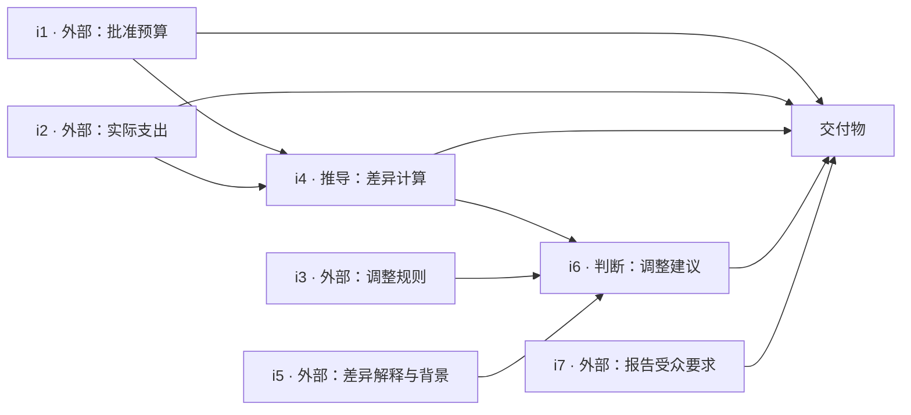
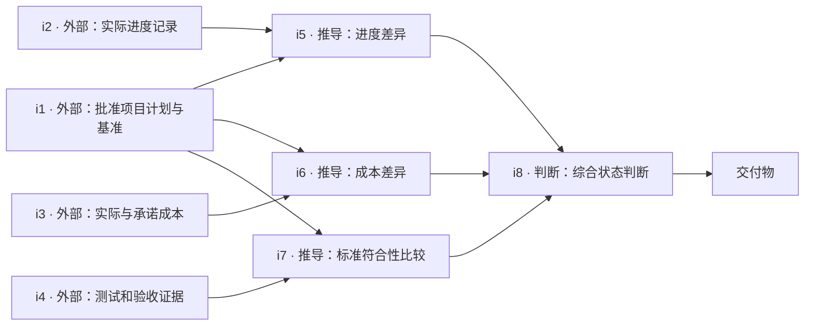
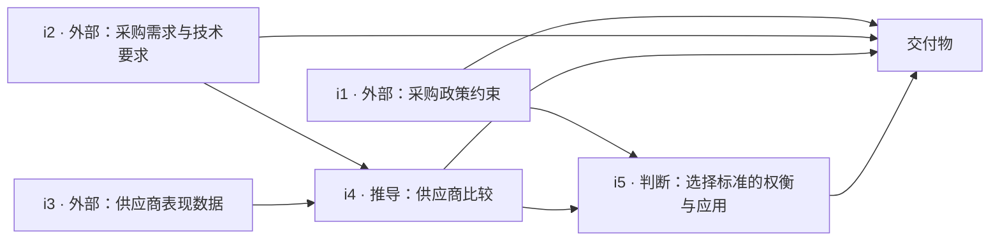
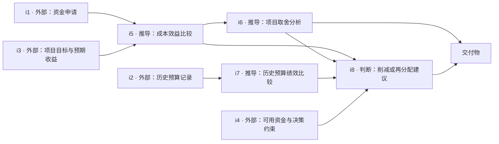

# Stage 2 · Intent-first Information Planning

本阶段把 Stage 1 已采样的职业 Seed 转为明确的工作目标、交付物和最小信息依赖图。信息节点描述**需要知道什么**，尚未提供任何具体案例事实、附件或答案。Stage 1 的数据保持不变。


参考 [WorkFactory §3.3 Information-level Planning](https://arxiv.org/html/2610.37161v1)：从预期输出倒推中间分析、判断和输入。这里只实现抽象信息规划，不实现论文后续材料构建等环节，也不提前绑定信息载体。用户提出的“intent → 搜索相关资料 → 查看资料 → 形成任务”可以作为后续路线；当前先明确搜索需要满足的信息要求，实际检索和案例落地留待下一阶段决定。

## 输入和输出

只读取 `work-seeds/data/work_seed_pilot_v2/` 的三个文件：`sampled_seed_ids.jsonl`、`candidate_seeds.jsonl`、`occupational_evidence.jsonl`。按采样文件的顺序处理，用 `seed_id` 关联，核对 Seed 内容哈希、Evidence ID 及职业—DWA 关系。职业证据仅帮助核对职业合理性，不能被当作案例材料；`input_file_families` 仅是上游提示。

| 文件 | 用途 |
|---|---|
| [scripts/plan_intents.py](scripts/plan_intents.py) | CLI、输入关联、生成提示、图检查、独立审核、断点和报告 |
| [config/pilot_rejections.json](config/pilot_rejections.json) | 本次代码代理逐条复核的两项拒绝记录，可重放；不修改模型原始计划 |
| [config/plan.schema.json](config/plan.schema.json) | 精确约束五个输出字段及三种信息节点类型 |
| [data/pilot/work_plans.jsonl](data/pilot/work_plans.jsonl) | 通过检查的真实模型生成计划，无重复职业字段 |
| [data/pilot/planning_report.json](data/pilot/planning_report.json) | 数量、失败原因、每项检查、逐边理由、模型及运行元数据 |
| [tests/test_planning.py](tests/test_planning.py) | 图结构、关联、语义结果处理、断点恢复和复现测试 |
| `data/cache/llm/` | 模型原始响应和生成时间，本地缓存，不提交 Git |
| `data/cache/records/` | 每个 Seed 的检查点，包括失败记录，不提交 Git |

复用 Stage 1 的 `llm_call`、JSONL 读写和哈希函数；共享调用函数仅新增可选 `prompt_version` 参数，原 Stage 1 默认行为不变。没有新增服务或训练依赖。

## 如何执行

在仓库根目录运行。复用 Stage 1 已有的 `jsonschema` 依赖：

```bash
python -m venv .venv  # 已有虚拟环境可跳过
.venv/bin/python -m pip install -r work-seeds/requirements-seeds.txt

# 首次运行：在隐藏输入提示中提供 LLMCenter accessKey
.venv/bin/python work-plans/scripts/plan_intents.py --limit 4 \
  --audit-rejections work-plans/config/pilot_rejections.json --prompt-api-key

# 相同输入、代码、配置和本地缓存：无需 Key，恢复/复现结果
.venv/bin/python work-plans/scripts/plan_intents.py --limit 4 \
  --audit-rejections work-plans/config/pilot_rejections.json

# 显式指定路径；改变实验参数时使用新的输出目录
.venv/bin/python work-plans/scripts/plan_intents.py \
  --input-dir work-seeds/data/work_seed_pilot_v2 \
  --output-dir work-plans/data/another_pilot \
  --cache-dir work-plans/data/cache \
  --config work-seeds/config/seed_pipeline.llmcenter.json \
  --limit 1 --prompt-api-key

.venv/bin/python -m unittest discover -s work-plans/tests -v
.venv/bin/python -m unittest discover -s work-seeds/tests -v
```

默认复用 LLMCenter 配置：请求 accessId 为 `GLM_ka48dn`，本次响应模型为 `glm-5.2`；模型、Endpoint、温度等参数均可通过配置替换。也可由本地安全方式注入配置指定的 `WORK_SEEDS_API_KEY` 环境变量。Key 不写入输出、缓存或 Git。

`--limit` 默认 4，0 不调用模型；它按原采样顺序截取，不重新采样。`--retry-errors` 只重试请求/响应错误，使用相同提示，不修改被拒绝的计划。语义或图结构拒绝会保留失败记录，不自动修复。

输入、选中 ID、参数、提示版本、Schema 和脚本哈希共同标识一次运行。相同输入及缓存得到字节一致的输出；模型重新生成即使温度为零，也不保证字节相同。原始模型响应缓存未纳入 Git，换机器需安全复制本地缓存才能复现原请求结果；已提交的计划和报告可直接检查。改变配置或代码时脚本要求新的输出目录，避免混淆实验。

## 信息节点与质量边界

- `external_input`：之后必须取得的事实、记录或约束，是图的根节点。
- `derived_information`：需要通过比较、计算或分析得到的信息，不能预填结果。
- `professional_judgment`：依据证据作出的判断或建议，不能预先替执行者下结论。
- 交付物为终点；分析表若只是报告的一部分，放在信息节点，不额外拆成交付物。

确定性检查覆盖：Schema、已采样 Seed、全局节点唯一、有效依赖引用、无环、外部输入为根、推导/判断有前提、交付物有信息输入且为终点、所有信息最终服务交付物。额外用保守词法规则拦截显式数字、日期、URL、部分公司后缀、格式绑定和明显预填答案。这些词法规则会漏检，也可能误伤，不能证明没有编造事实。

另一轮模型调用审核目标一致性、职业合理性、最小性、信息类型与充分性、依赖逻辑、案例中立、无预填答案和无载体绑定。每条边都需要单独的理由。确定性结果与语义结果分开保存；只有两者均通过且没有额外复核拒绝时才导出计划。模型审核仍需人工抽查，不能作为事实正确性的充分证明。`--audit-rejections` 可接入独立复核的拒绝理由，单独记录在报告中；它只能拒绝，不能把失败改成通过，也不会掩盖请求错误。本次复核由代码代理完成，不冒充人工专家验收。每项拒绝绑定原计划的 SHA-256，重新生成后不允许套用旧决定；该文件的内容和哈希纳入运行标识。

开发时 v1 提示的首轮试跑为 3 条通过、1 条图结构拒绝；检查还发现扩大任务范围的风险，因此统一收紧提示。v2 的 4 条都通过自动检查，但逐条阅读发现软件质量判断不能仅依赖完成进度。因此 v3 明确要求标准评估包含测试、验收或实际属性证据，并核对交付物是否有足够的信息输入。每次均从原始 Seed 重新生成，没有把旧计划交给自动 Repair 流程。前两轮的原始响应及报告保留在本地缓存（报告位于 `data/cache/archive/prompt_v1/` 和 `prompt_v2/`），最终输出与其分开。生成提示固定为 v3 后，独立审核更新到 v4，进一步检查每个推导节点描述中的前提是否有实际依赖路径；复用生成缓存，不改写计划。上一版审核结果保存在 `data/cache/archive/review_v3/`。

## 四条实际 Pilot

本节对应最终 `data/pilot/` 运行结果。计划全文保持模型生成的英文；下方中文仅帮助阅读。

**输入 4，生成 4，结构检查通过 4，模型审核通过 4；额外复核后准入 2、拒绝 2、请求错误 0。** 本轮未得到四条均可准入的计划，不能把有已知缺陷的图强行导出为通过结果。

| 计划 | 信息节点 | 边 | 最终状态 | 原因 |
|---|---:|---:|---|---|
| 预算差异与调整建议 | 7 | 10 | 通过 | 检查通过，仍属 Pilot |
| 软件项目进度监控 | 8 | 10 | 通过 | 包含独立质量/验收证据需求 |
| 采购指南 | 5 | 8 | 复核拒绝 | 增加了原始指南任务不要求的供应商比较目标 |
| 项目削减支出或资金再分配 | 8 | 10 | 复核拒绝 | 取舍分析使用预算绩效，却缺少该信息的依赖路径 |

全部生成计划平均 **7 个信息节点、9.5 条边**；最终通过计划平均 **7.5 个信息节点、10 条边**。`work_plans.jsonl` 只含两条通过记录；下面完整保存四条原始生成计划供阅读，拒绝记录不混入准入文件。拒绝表示本次生成不合格，不代表这两类职业工作不能规划。

最终使用生成提示 v3、独立审核 v4。一次审核曾返回不完整 JSON：原响应移入 `data/cache/archive/invalid_response/` 后用相同提示重试，最终成功；未修改任何模型输出以修正格式。普通断点恢复保留错误，遇到已缓存的无效响应应先归档该响应，再用 `--retry-errors` 重试，而不是反复读同一份损坏缓存。

验证：Stage 2 的 18 项单元测试与 Stage 1 的 33 项回归测试通过；真实 Pilot 使用缓存离线重放，输出字节一致；全部 33 个已跟踪的 Stage 1 数据文件与本次工作前一致。

### 预算差异与调整建议

`seed_557eec0637616419be8bbe23`

批准预算与实际支出 → 差异计算；差异、预算约束及解释材料 → 调整建议 → 面向组织负责人的书面报告。

以下图逐边对应原始生成 JSON，不人工补边；是否准入以本节最终统计和运行报告为准。



<details>
<summary>查看完整英文模型输出（包含未通过计划，勿直接作为准入数据）</summary>

```json
{
  "deliverables": [
    {
      "description": "A written variance analysis and reconciliation report addressed to officials, presenting the differences between approved budget and actual spending, their magnitude and composition, and recommended changes to reconcile those differences.",
      "id": "out1",
      "type": "report"
    }
  ],
  "dependencies": [
    [
      "i1",
      "i4"
    ],
    [
      "i2",
      "i4"
    ],
    [
      "i4",
      "i6"
    ],
    [
      "i3",
      "i6"
    ],
    [
      "i5",
      "i6"
    ],
    [
      "i1",
      "out1"
    ],
    [
      "i2",
      "out1"
    ],
    [
      "i4",
      "out1"
    ],
    [
      "i6",
      "out1"
    ],
    [
      "i7",
      "out1"
    ]
  ],
  "information_nodes": [
    {
      "description": "The approved budget figures for the relevant organizational units, programs, or spending categories, broken down consistently with the spending records.",
      "id": "i1",
      "type": "external_input"
    },
    {
      "description": "The actual spending records for the same organizational units, programs, or categories and the same scope and period as the approved budget.",
      "id": "i2",
      "type": "external_input"
    },
    {
      "description": "Organizational rules, policies, and reconciliation criteria that govern permissible budget adjustments, transfers, or corrective actions available to reconcile variances.",
      "id": "i3",
      "type": "external_input"
    },
    {
      "description": "Computed variances between approved budget and actual spending by category, unit, or program, including direction and magnitude of each difference and their relative contribution to the total variance.",
      "id": "i4",
      "type": "derived_information"
    },
    {
      "description": "Relevant explanations, supporting documentation, or operational context accounting for the identified spending differences, where such records are available.",
      "id": "i5",
      "type": "external_input"
    },
    {
      "description": "Assessment of which variances require reconciliation action and what specific changes to budget allocations, spending controls, or adjustments are appropriate, based on the magnitude and nature of the differences and applicable organizational rules.",
      "id": "i6",
      "type": "professional_judgment"
    },
    {
      "description": "Requirements and preferences of the officials who are the audience for the report, including the level of detail, focus areas, and decision support they need.",
      "id": "i7",
      "type": "external_input"
    }
  ],
  "seed_id": "seed_557eec0637616419be8bbe23",
  "work_objective": "Prepare a written report that analyzes the variance between an approved budget and actual spending, and communicates recommended changes to reconcile the differences to an organization's officials."
}
```

</details>

### 软件项目进度监控

`seed_fd10d1bb12e351e2266e1dfb`

项目基准 + 实际进度／支出／质量证据 → 进度、成本、标准符合性比较 → 综合状态判断 → 状态摘要。

以下图逐边对应原始生成 JSON，不人工补边；是否准入以本节最终统计和运行报告为准。



<details>
<summary>查看完整英文模型输出（包含未通过计划，勿直接作为准入数据）</summary>

```json
{
  "deliverables": [
    {
      "description": "A concise project progress status summary reporting the project's schedule position against deadlines, conformance to applicable standards, and cost position against cost targets, with an overall progress assessment and any variances identified during monitoring.",
      "id": "out1",
      "type": "status_summary"
    }
  ],
  "dependencies": [
    [
      "i1",
      "i5"
    ],
    [
      "i2",
      "i5"
    ],
    [
      "i1",
      "i6"
    ],
    [
      "i3",
      "i6"
    ],
    [
      "i1",
      "i7"
    ],
    [
      "i4",
      "i7"
    ],
    [
      "i5",
      "i8"
    ],
    [
      "i6",
      "i8"
    ],
    [
      "i7",
      "i8"
    ],
    [
      "i8",
      "out1"
    ]
  ],
  "information_nodes": [
    {
      "description": "The approved project plan defining planned milestones, deadlines, applicable standards or acceptance criteria, and cost targets for the project across its planning through implementation phases.",
      "id": "i1",
      "type": "external_input"
    },
    {
      "description": "Current project progress records: milestone completion status, actual activity dates, and work completed to date against planned work.",
      "id": "i2",
      "type": "external_input"
    },
    {
      "description": "Cost records showing actual expenditures incurred and committed costs to date against the approved budget.",
      "id": "i3",
      "type": "external_input"
    },
    {
      "description": "Quality and standards evidence: results of tests, reviews, or acceptance checks, and observed properties of produced work products relative to the applicable standards and acceptance criteria.",
      "id": "i4",
      "type": "external_input"
    },
    {
      "description": "Comparison of actual schedule progress and milestone completion against planned deadlines, identifying schedule variances and the current deadline status.",
      "id": "i5",
      "type": "derived_information"
    },
    {
      "description": "Comparison of actual cost expenditures to date against cost targets, identifying cost variances and the current budget status.",
      "id": "i6",
      "type": "derived_information"
    },
    {
      "description": "Assessment of observed quality and test results against the applicable standards and acceptance criteria, identifying conformance or non-conformance.",
      "id": "i7",
      "type": "derived_information"
    },
    {
      "description": "Overall assessment of whether the project is meeting deadlines, standards, and cost targets, with a judgment on the significance of identified variances and any areas requiring the supervisor's attention.",
      "id": "i8",
      "type": "professional_judgment"
    }
  ],
  "seed_id": "seed_fd10d1bb12e351e2266e1dfb",
  "work_objective": "Monitor a software project's progress from planning through implementation by reconciling its actual schedule, quality/standards conformance, and cost performance against the approved plan, and produce a status summary that reports progress against deadlines, standards, and cost targets."
}
```

</details>

### 采购指南

`seed_f72f218a6cef34260ae1bd01`

采购政策、采购需求和供应商数据 → 比较与标准权衡 → 指南。注意：这是待审核的实际生成内容，供应商比较可能扩大原始编写指南任务的范围。

以下图逐边对应原始生成 JSON，不人工补边；是否准入以本节最终统计和运行报告为准。



<details>
<summary>查看完整英文模型输出（包含未通过计划，勿直接作为准入数据）</summary>

```json
{
  "deliverables": [
    {
      "description": "Written procurement guidelines specifying the criteria for supplier and merchandise selection across price, quality, availability, reliability, and technical support, including the judgment basis for applying each criterion.",
      "id": "out1",
      "type": "guidelines"
    }
  ],
  "dependencies": [
    [
      "i1",
      "i5"
    ],
    [
      "i2",
      "i4"
    ],
    [
      "i3",
      "i4"
    ],
    [
      "i4",
      "i5"
    ],
    [
      "i1",
      "out1"
    ],
    [
      "i2",
      "out1"
    ],
    [
      "i4",
      "out1"
    ],
    [
      "i5",
      "out1"
    ]
  ],
  "information_nodes": [
    {
      "description": "Organizational procurement policy framework, required supplier ethical standards, and any existing procurement procedures that the guidelines must align with.",
      "id": "i1",
      "type": "external_input"
    },
    {
      "description": "Records or specifications describing goods and services being purchased, including required technical characteristics relevant to assessing suppliers and merchandise.",
      "id": "i2",
      "type": "external_input"
    },
    {
      "description": "Observed supplier and merchandise data across the relevant criteria: pricing structures, quality measures, availability levels, reliability history, and technical support offerings.",
      "id": "i3",
      "type": "external_input"
    },
    {
      "description": "Comparative analysis of suppliers and merchandise against each criterion, categorized by criterion type, to identify where offerings differ or align.",
      "id": "i4",
      "type": "derived_information"
    },
    {
      "description": "Assessments of which supplier and merchandise criteria are most decision-relevant given organizational needs, and recommendations on how buyers should weigh and apply each criterion in selection decisions.",
      "id": "i5",
      "type": "professional_judgment"
    }
  ],
  "seed_id": "seed_f72f218a6cef34260ae1bd01",
  "work_objective": "Draft procurement guidelines that define the criteria buyers and purchasing agents apply when selecting suppliers and merchandise, covering price, quality, availability, reliability, and technical support."
}
```

</details>

### 项目削减支出或资金再分配

`seed_c651450be087dfe86854b1ab`

资金申请、预期收益、历史预算和约束 → 成本效益与取舍分析 → 削减／再分配建议 → 决策备忘录。注意 i6 声称使用预算绩效，却未连入历史预算分析 i7；这说明仅有 DAG 和连通性不够。

以下图逐边对应原始生成 JSON，不人工补边；是否准入以本节最终统计和运行报告为准。



<details>
<summary>查看完整英文模型输出（包含未通过计划，勿直接作为准入数据）</summary>

```json
{
  "deliverables": [
    {
      "description": "A decision memo recommending specific spending cuts on particular programs or redistribution of extra funds, supported by the cost-benefit analysis, program tradeoff assessment, and past budget evidence.",
      "id": "out1",
      "type": "decision_memo"
    }
  ],
  "dependencies": [
    [
      "i1",
      "i5"
    ],
    [
      "i3",
      "i5"
    ],
    [
      "i5",
      "i6"
    ],
    [
      "i2",
      "i7"
    ],
    [
      "i5",
      "i8"
    ],
    [
      "i6",
      "i8"
    ],
    [
      "i7",
      "i8"
    ],
    [
      "i4",
      "i8"
    ],
    [
      "i6",
      "out1"
    ],
    [
      "i8",
      "out1"
    ]
  ],
  "information_nodes": [
    {
      "description": "The organization's financial requests submitted by individual programs, including requested amounts and the stated purpose or justification for each request.",
      "id": "i1",
      "type": "external_input"
    },
    {
      "description": "Historical budget records for the relevant programs, covering prior-period allocations and actual expenditures, aligned by program and period for comparison.",
      "id": "i2",
      "type": "external_input"
    },
    {
      "description": "Documented program objectives and expected outcomes or benefits associated with each program under review, used as the benefit side of the cost-benefit assessment.",
      "id": "i3",
      "type": "external_input"
    },
    {
      "description": "Organizational constraints and criteria relevant to funding decisions, such as total available funds, mandatory spending obligations, and any stated priorities or restrictions.",
      "id": "i4",
      "type": "external_input"
    },
    {
      "description": "Cost-benefit comparison of each program's financial request against its stated objectives and expected outcomes, leaving benefit and cost values open.",
      "id": "i5",
      "type": "derived_information"
    },
    {
      "description": "Tradeoff analysis contrasting programs by comparing their costs, benefits, and budget performance against one another on a consistent basis.",
      "id": "i6",
      "type": "derived_information"
    },
    {
      "description": "Comparison of past budget allocations and actual expenditures by program and period to identify spending patterns and variances, leaving amounts and results open.",
      "id": "i7",
      "type": "derived_information"
    },
    {
      "description": "Assessment of which programs warrant spending cuts and where extra funds should be redistributed, based on the cost-benefit and tradeoff findings and constrained by available criteria and obligations.",
      "id": "i8",
      "type": "professional_judgment"
    }
  ],
  "seed_id": "seed_c651450be087dfe86854b1ab",
  "work_objective": "Formulate recommendations on cutting spending on particular programs or redistributing extra funds, grounded in a cost-benefit analysis of financial requests, program tradeoffs, and past budget performance."
}
```

</details>
