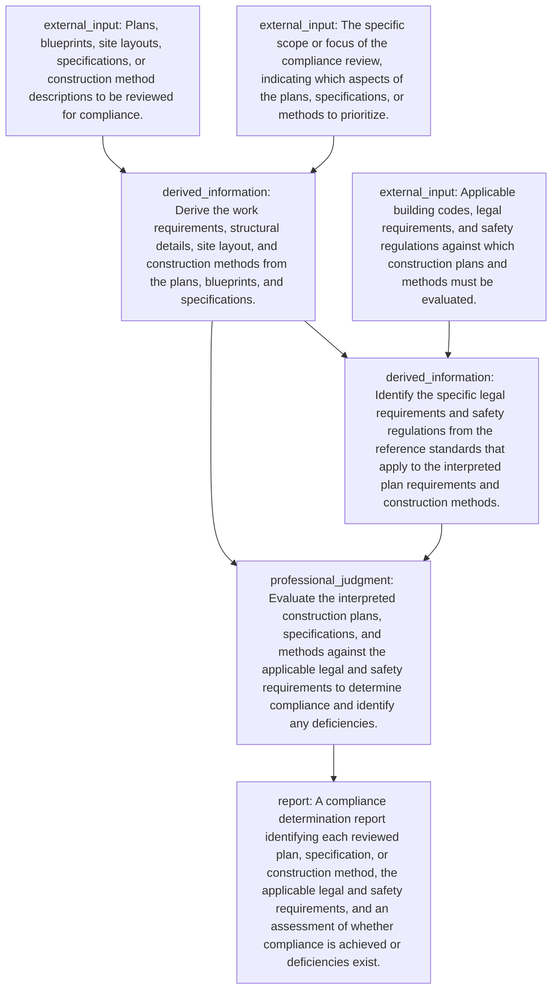

# Semantic Planning Pilot 对照

| 指标 | 旧版直接 Graph | 新版语义规划 + Python 编译 |
|---|---:|---:|
| 同批输入 | 10 | 10 |
| 结构通过 | 5/10 | 6/10 |
| 语义审核通过 / 全部输入 | 2/10 | 5/10 |
| 语义审核通过 / 尝试审核 | 2/5 | 5/6 |

本轮 1 条审核响应不是合法 JSON，未准入；不将它解释为职业语义错误。其余 4 条因格式或类别约束失败，未进入审核。原始职业任务逐字段、逐哈希保持不变。

| Seed | 旧版 | 新版 | 原因 |
|---|---|---|---|
| raw_31_0_13744 | failed | failed | schema:['inputs', 5, 'kind']: 'external_reference' is not one of ['text_instruction', 'document', 'table', 'image', 'diagram', 'code', 'structured_data'] |
| raw_31_0_16209 | failed | accepted |  |
| raw_31_0_16425 | accepted | failed | llm_response_not_json |
| raw_31_0_18983 | failed | accepted |  |
| raw_31_0_21094 | accepted | failed | schema:['inputs', 2, 'preferred_formats', 2]: 'html' is not one of ['csv', 'docx', 'ipynb', 'jpeg', 'jpg', 'js', 'json', 'md', 'pdf', 'png', 'pptx', 'py', 'svg', 'tex', 'tiff', 'txt', 'xlsx'] |
| raw_31_0_21676 | rejected | failed | format_not_allowed_for_kind:structured_data |
| raw_31_0_22125 | rejected | accepted |  |
| raw_31_0_3405 | rejected | failed | format_not_allowed_for_kind:table |
| raw_31_0_3747 | failed | accepted |  |
| raw_31_0_871 | failed | accepted |  |

## 实际示例：建筑图纸合规检查

模型输出只含语义规划；ID、Graph 与假设状态由程序生成。以下是保存的实际响应，不是人工样例。

```json
{
  "deliverable": {
    "description": "A compliance determination report identifying each reviewed plan, specification, or construction method, the applicable legal and safety requirements, and an assessment of whether compliance is achieved or deficiencies exist.",
    "kind": "report",
    "preferred_formats": [
      "pdf",
      "docx",
      "md"
    ],
    "requires": [
      "compliance_assessment"
    ]
  },
  "inputs": [
    {
      "description": "Plans, blueprints, site layouts, specifications, or construction method descriptions to be reviewed for compliance.",
      "kind": "document",
      "modality_dependency": {
        "information_needed": "Spatial layout, dimensions, structural relationships, and site arrangement depicted in blueprints or site plans",
        "modality": "visual_spatial",
        "required_operation": "Interpret spatial layout and structural details to identify what is being built and how, enabling comparison against code requirements",
        "supports": "interpret_plan_requirements"
      },
      "name": "construction_plans_specifications",
      "preferred_formats": [
        "pdf",
        "docx",
        "md",
        "txt"
      ],
      "source": "workspace"
    },
    {
      "description": "Applicable building codes, legal requirements, and safety regulations against which construction plans and methods must be evaluated.",
      "kind": "document",
      "name": "legal_safety_requirements",
      "preferred_formats": [
        "pdf",
        "docx",
        "txt",
        "md"
      ],
      "source": "external_reference"
    },
    {
      "description": "The specific scope or focus of the compliance review, indicating which aspects of the plans, specifications, or methods to prioritize.",
      "kind": "text_instruction",
      "name": "inspection_scope",
      "preferred_formats": [],
      "source": "task_instruction"
    }
  ],
  "objective": "Review and interpret plans, blueprints, site layouts, specifications, or construction methods to determine compliance with legal requirements and safety regulations.",
  "operations": [
    {
      "description": "Derive the work requirements, structural details, site layout, and construction methods from the plans, blueprints, and specifications.",
      "name": "interpret_plan_requirements",
      "requires": [
        "construction_plans_specifications",
        "inspection_scope"
      ],
      "type": "derived_information"
    },
    {
      "description": "Identify the specific legal requirements and safety regulations from the reference standards that apply to the interpreted plan requirements and construction methods.",
      "name": "identify_applicable_requirements",
      "requires": [
        "interpret_plan_requirements",
        "legal_safety_requirements"
      ],
      "type": "derived_information"
    },
    {
      "description": "Evaluate the interpreted construction plans, specifications, and methods against the applicable legal and safety requirements to determine compliance and identify any deficiencies.",
      "name": "compliance_assessment",
      "requires": [
        "interpret_plan_requirements",
        "identify_applicable_requirements"
      ],
      "type": "professional_judgment"
    }
  ]
}
```

编译后的图：



文件格式均为偏好；本轮没有检索或生成这些文件，没有证明视觉必要性。Direct Answer、TEX 等已实现并通过夹具测试，但未强制塞入本轮准入样本。
